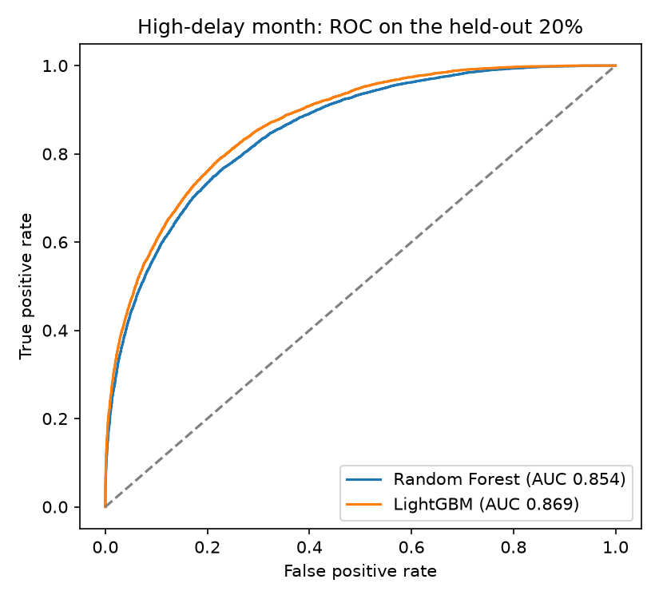
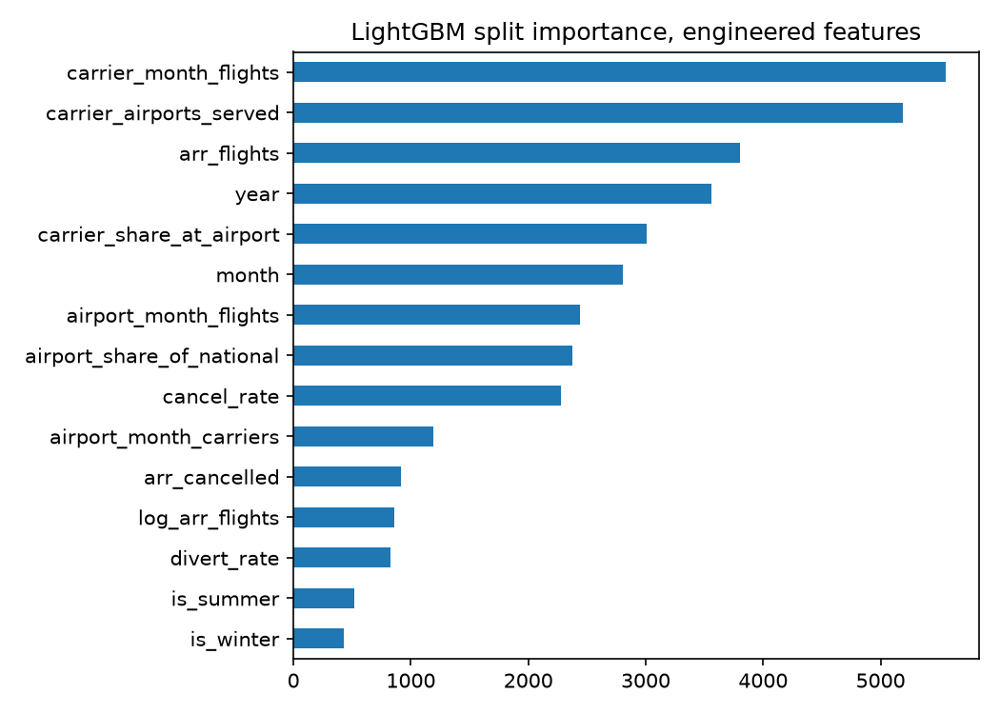

# Airline Delay Risk Prediction

Which carrier-airport-months will be bad for delays? This project predicts whether a given
carrier at a given airport in a given month will be a **high-delay period**, defined as at least
20% of arriving flights delayed by 15 minutes or more, using the U.S. Bureau of Transportation
Statistics monthly on-time summary (171,666 carrier x airport x month rows, 2013 to 2023).

Course project for CSCI 5523 Data Mining, University of Minnesota, Fall 2025, Group 5 with
Rochelle Kwang, Saanvi Surve and Sathvik Murthy. My part was the LightGBM model: training,
hyperparameters and handling the class imbalance.

## The leakage trap

The BTS table has columns for the *causes* of delay in each month: `carrier_ct`, `weather_ct`,
`nas_ct`, `late_aircraft_ct` and the matching delay minutes. They look like features. They are
not: they are a breakdown of the very delays the target counts, so a model given them scores
near-perfectly and learns nothing usable before the month happens. `train.py` drops all twelve of
them and builds the features only from things known in advance.

## Features (18 engineered + one-hot carrier and airport)

| Group | Features |
|---|---|
| Traffic volume | arrivals that month, log arrivals |
| Airport congestion | total arrivals at the airport that month, number of carriers serving it, the airport's share of national traffic |
| Carrier scale and competition | the carrier's arrivals that month, airports it served, its share of the airport's arrivals |
| Disruption | cancellations, diversions, and both as rates |
| Seasonality | year, month, quarter, summer, holiday season, winter |
| Identity | carrier and airport, one-hot encoded (412 columns) |

Target balance: 39% of rows are high-delay months. Both models use `class_weight="balanced"`.

## Results

Stratified 80/20 split, 136,978 training rows, 34,245 held out. Numbers are from `results/metrics.json`,
produced by `python train.py`.

| Model | Accuracy | ROC-AUC | High-delay precision | High-delay recall | F1 (high delay) |
|---|---|---|---|---|---|
| Random Forest (300 trees) | 77.1% | 0.854 | 0.69 | 0.75 | 0.72 |
| LightGBM (800 rounds, 63 leaves) | 78.1% | 0.869 | 0.69 | 0.79 | 0.74 |

LightGBM wins on every metric, most usefully on recall for the high-delay class: it catches 79%
of bad months against 75% for the forest, at the same precision. In the course report, which used
a slightly different feature set, the same comparison came out at 0.83 versus 0.849 AUC.



The engineered features LightGBM split on most were the carrier's monthly volume and the number
of airports it served, the row's own arrival count, year, the carrier's share at the airport, month,
airport volume and share of national traffic, and the cancellation rate.



## Run it

```bash
python -m venv .venv && source .venv/bin/activate
pip install -r requirements.txt
# put Airline_Delay_Cause.csv in data/ (download below), then:
python train.py
```

Runs in about 90 seconds on a laptop CPU and writes `results/metrics.json`, `results/roc.png` and
`results/feature_importance.png`.

## Data

`Airline_Delay_Cause.csv` is the BTS "Airline On-Time Statistics and Delay Causes" monthly
download (transtats.bts.gov, "Airline Delay Cause" report), one row per carrier, airport and month.
It is 28 MB and not committed; the same file is mirrored on Kaggle under that name.
